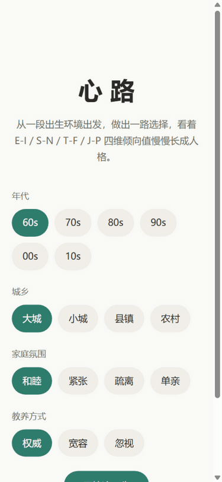

# 心路 · 人格演化人生模拟

> 一段出生环境，上百个人生抉择——看 E-I / S-N / T-F / J-P 四维倾向值，慢慢长成一个人格。

**心路**是一款纯前端的文字人生模拟游戏：从年代、城乡、家庭氛围、教养方式四个要素定盘开局，
在婴儿到老年的 8 个人生阶段里逐张应对事件卡；每一次选择都在四维倾向值上留下偏移，
阶段小结的手绘雷达图与演化曲线记下全部轨迹，终局凝结成一份带关键抉择复盘的人格报告。



## 30 秒跑起来

线上地址：**[yuluo554.github.io/xinlu](https://yuluo554.github.io/xinlu/)**（发布留档见 `plan/05-发布留档.md`）。

本地运行只需两条命令（Node ≥ 20）：

```bash
npm install
npm run dev      # 浏览器打开 http://localhost:5173
```

零运行时依赖：`dependencies` 恒空，全部逻辑为原生 TypeScript + 手绘 SVG；单机离线可玩，
进度保存在本机浏览器 localStorage（`xinlu.save.v1`），无账号、无网络请求、不上传任何数据。

## 玩法与内容规模

- **开局定盘**：出生环境四要素共 288 种组合，决定四维的初始倾向；
- **卡片人生**：8 个阶段共 121 条事件（每阶段 main 4 / context 9 / critical 2–3），
  其中 16 次重大抉择会显著改写轨迹；
- **演化报告**：8 条件结局 + 1 兜底结局全部实玩与线性策略双路可达（引擎级 96 组扫描守护），16 型 MBTI 画像全文收束；
  终局面展示本局种子——同种子同选择，结果可复现。

以上数字由数据门自动对账：`npm run validate -- --count`。

## v2 新增：人格鱼、图鉴与分享卡

- **人格鱼 mascot**：四维倾向值实时参数化一条鱼的形态与表情，全程陪伴（选项反馈 / 阶段小结 / 终局主视觉）；
- **16 型图鉴**：开局屏进入，通关自动入册（本机 `xinlu.gallery.v2`），终局提示还有几型未解锁；
- **终局分享卡**：一键导出 1080×1440 PNG，纯客户端生成、零上传；
- **场景氛围**：出生环境映射水域背景与云层，八个小结配海洋图标；
- 全部素材许可与署名见 [素材与许可说明](public/credits.md)。

## 人格模型依据

维度定义仅作游戏化表达框架，**娱乐向定位，不构成心理测评**。

| 依据 | 来源 | 查证状态 |
|---|---|---|
| MBTI 四维（E-I / S-N / T-F / J-P）公开定义 | 英文维基百科 MBTI 条目（引注 MBTI Manual 3rd ed. /《Gifts Differing》/ Myers & Briggs Foundation） | ✅ 已核对（2026-10-24） |
| 品类参照：人生重开模拟器传播度 | GitHub 开源项目 VickScarlet/lifeRestart 及多个派生仓库 | ✅ 已核对（2026-10-24） |
| 开源同类空白（人格演化向人生模拟） | GitHub 检索（**软论据**，否定性结论无法穷尽验证） | 🟡 部分核对（2026-10-24） |

注：本作采用经典四维命名；16personalities 实际使用其自有命名（Mind/Energy/Nature/Tactics），并非同一口径。
查证渠道全文见 [data/README.md](data/README.md) 的依据查证三态表。

## 已知限制

1. MBTI 本身在心理测量学界存在重测信度与效度争议，本作定位**娱乐向**，不构成心理测评；
2. 事件为文学化模拟，不代表真实人生发展规律；
3. 存档仅在本机 localStorage，清浏览器数据即丢失（v1 不做云存档）；
4. 各 MBTI 路线的可达性与平衡依赖实玩调参，v1 不承诺统计意义上的均衡；
5. 本机网络直连 GitHub 受限，发布动作依赖镜像/代理通道（对策见 04 §风险）。

## 开发

- 开发文档索引：[DEVELOPMENT.md](DEVELOPMENT.md)——计划、口径、决策的唯一事实源在 [plan/](plan/00-README总览.md)；
- 数据台账与依据查证：[data/README.md](data/README.md)；
- 常用命令：`npm test`（单测）· `npm run typecheck`（类型检查）· `npm run validate`（数据门）· `npm run build`（产出 dist）。

## 项目进度

| 里程碑 | 状态 |
|---|---|
| M0 仓库骨架与脚手架 | ✅（2026-10-23） |
| M1 数据先行 | ✅（2026-10-24） |
| M2 演化引擎与存档 | ✅（2026-10-24） |
| M3 界面与可视化 | ✅（2026-10-24） |
| M4 完整内容 | ✅（2026-10-24） |
| M5 打磨与门面 | ✅（2026-10-24） |
| M6 发布 | ✅（2026-10-24） |
| v2-M1' 回归基线与内容修复（E2E / B1 / assets 策略） | ✅（2026-10-24） |
| v2-M2' 人格鱼 avatar（fish.ts + 常驻 mascot + 表情映射） | ✅（2026-10-24） |
| v2-M3' 分享卡 + 场景氛围 + 双门禁 | ✅（2026-10-24） |
| v2-M4' 图鉴 + 发布 v2.0.0 | ✅（2026-10-24，[tag v2.0.0](https://github.com/yuluo554/xinlu/releases/tag/v2.0.0)） |
| v3-M1'' 引擎与数据 v3（年龄单调/三观层/多线/资源/选项≥3/存档 v2 迁移） | ✅（2026-10-24，[docs/v3-M1-gates.md](docs/v3-M1-gates.md)） |
| v3-M2'' 时间轴画卷 + 叙事美术 + 游戏感三件（图标层/状态条/重量分级/微反馈） | ✅（2026-10-24，[docs/v3-M2-gates.md](docs/v3-M2-gates.md)） |

## 许可

[MIT](LICENSE)
