# M3 手动清单留痕（375 / 768 / 1280px + 一周目通关）

> 验证日期：2026-10-24。环境：Vite dev server（`npm run dev`，端口 5173）+ 内置浏览器实点实截。
> 证据截图位于 `docs/assets/`（文件名含视口档位）。验证完成后 dev server 已停止（按 HANDOFF §五 纪律）。

## 一、清单判据（DESIGN.md 设计规范 + plan/04 §M3）

| # | 判据 | 375 | 768 | 1280 |
|---|---|---|---|---|
| 1 | 浅色纸面底 + 单一强调色（玉青 #2f7d6d），无渐变无杂物 | ✅ | ✅ | ✅ |
| 2 | 圆角卡片 + 音调步进分区（无分隔线、无投影） | ✅ | ✅ | ✅ |
| 3 | 移动单列 / ≥768px 桌面加宽（760px 版心，小结与终局双列） | ✅ 单列 | ✅ 双列 | ✅ 双列 |
| 4 | 开局屏四要素可选、枚举来自 birth-map、能开局 | ✅ | ✅ | ✅ |
| 5 | 卡片流：事件文本、选项可点、aftermath 反馈可见 | ✅ | ✅ | ✅ |
| 6 | 阶段小结：手绘 SVG 雷达（含淡影）+ 四维 delta | ✅ | ✅ | ✅ |
| 7 | 终局报告：类型徽章 + 结局文案 + 雷达 + 演化曲线 + 复盘 + 关键抉择 | ✅ | ✅ | ✅ |
| 8 | 无横向滚动、无破版、触控目标 ≥44px | ✅ | ✅ | ✅ |
| 9 | 轻动效：入场浮起 0.28s，`prefers-reduced-motion` 兜底 | ✅ | ✅ | ✅ |
| 10 | 刷新续局（有档回到当前进度） | ✅ | — | — |
| 11 | 存档损坏提示可见、原文保留、显式重开才清档 | ✅ | — | — |

「—」= 该项为状态行为，与视口无关，在 375 档验证一次即可（行为逻辑不分档）。

## 二、证据截图

| 档位 | 开局 | 卡片流 | 阶段小结 | 终局报告 |
|---|---|---|---|---|
| 375×812 | 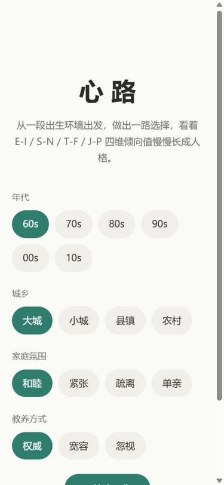 | 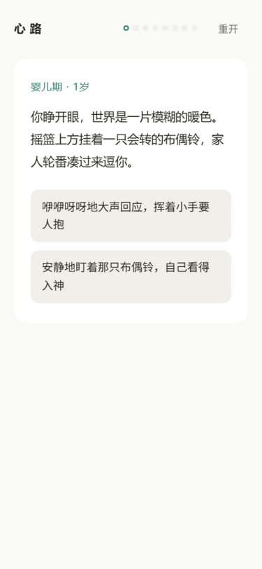 | 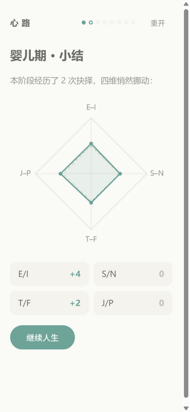 | 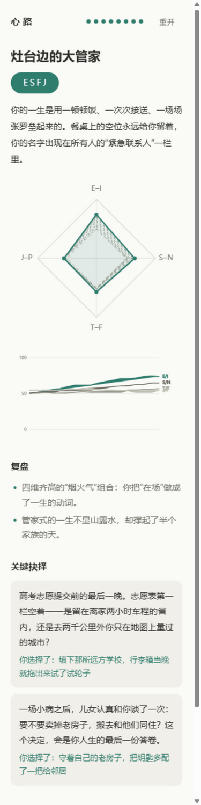 |
| 768×1024 | 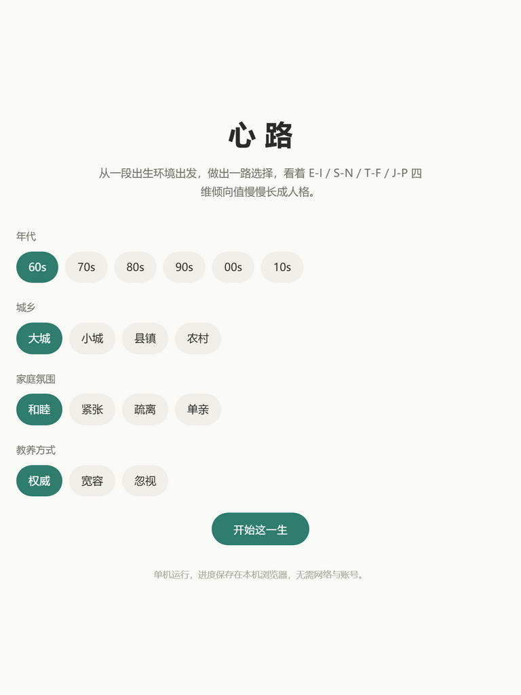 | 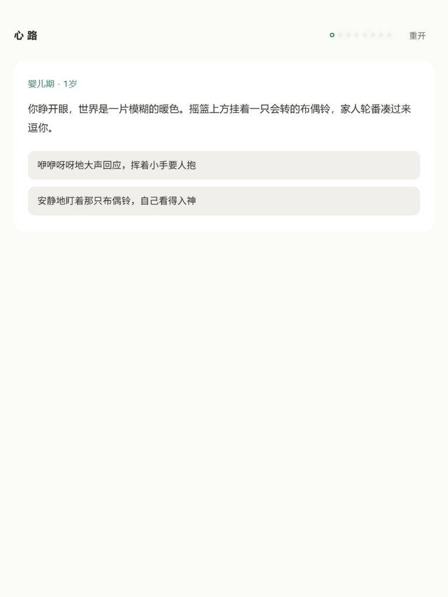 | 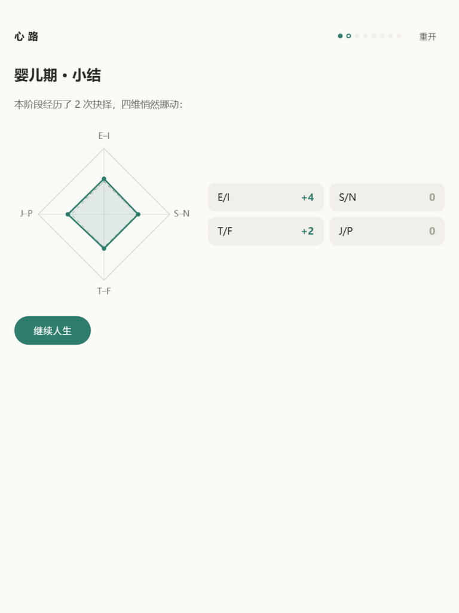 | 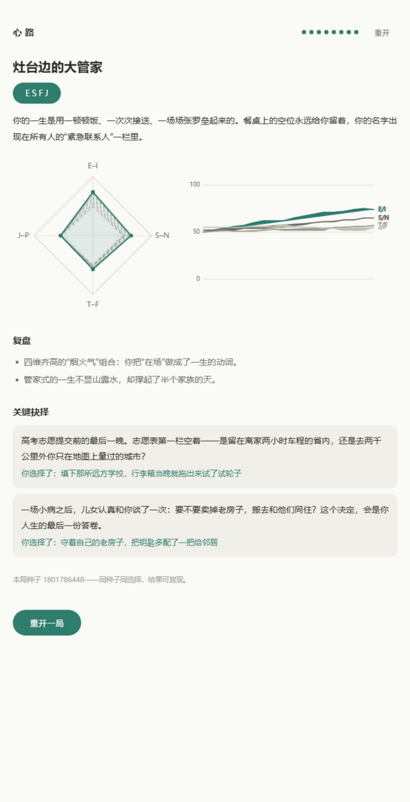 |
| 1280×800 | 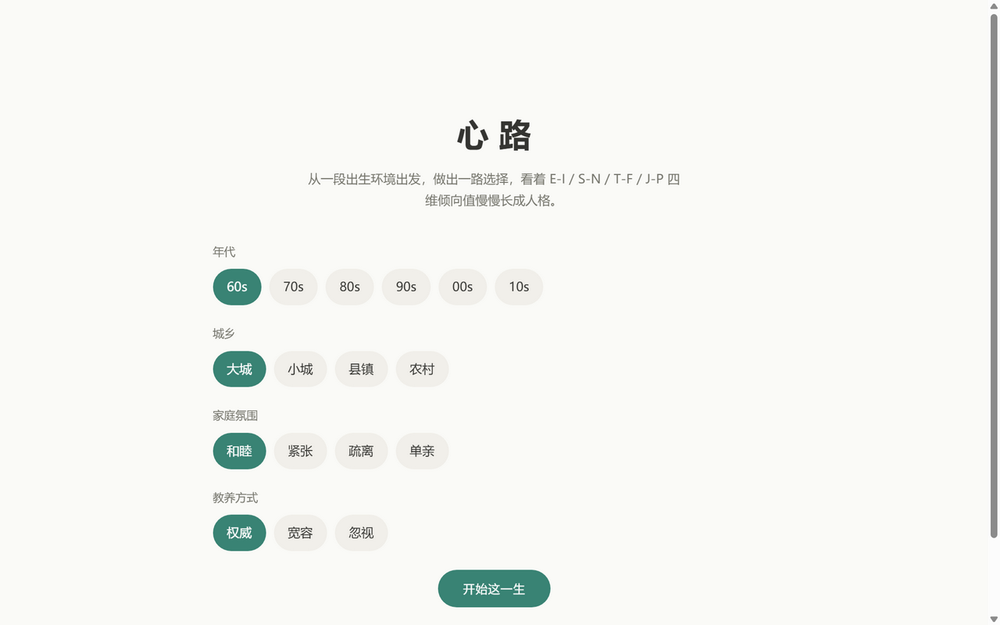 | 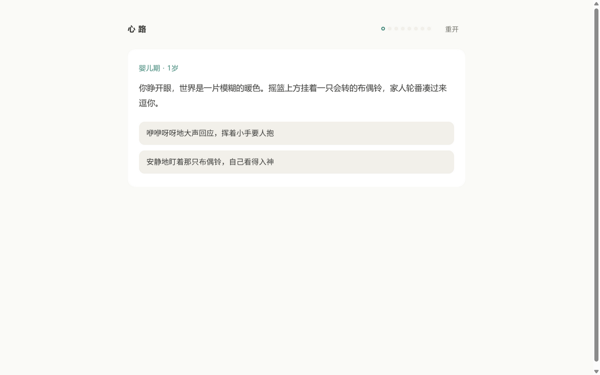 | 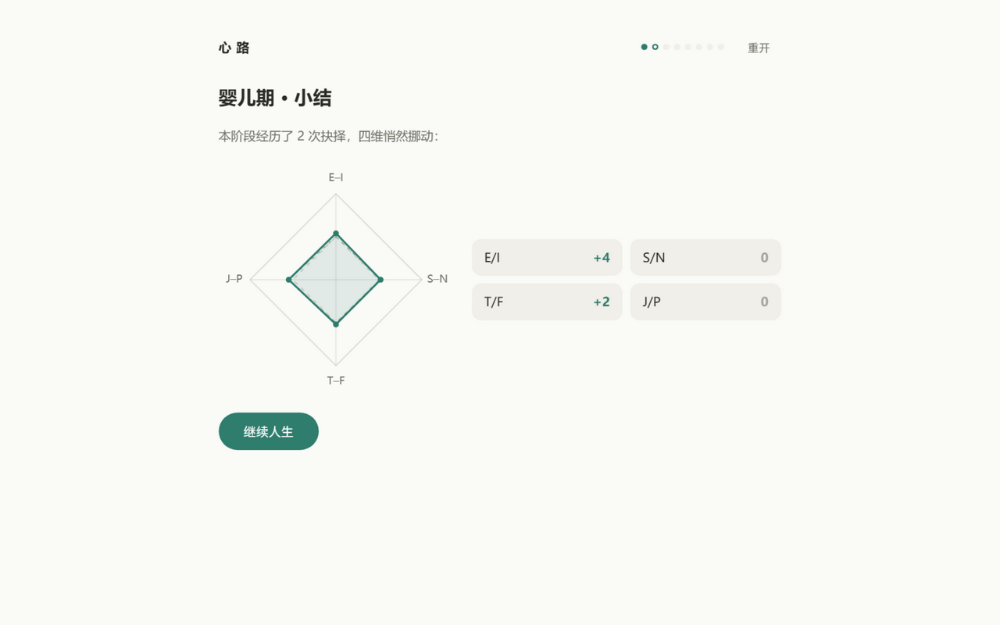 | 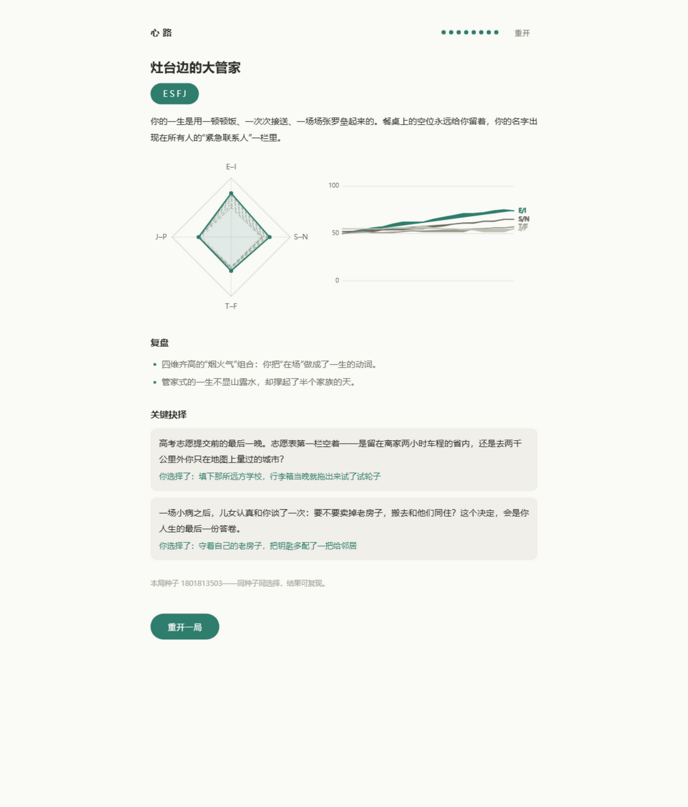 |

附加：存档损坏提示（375）→ [m3-375-corrupt.png](assets/m3-375-corrupt.png)

## 三、一周目完整通关留痕

- 375 档完整通关：全程 8 阶段 17 事件逐张实点，终局 **ESFJ「灶台边的大管家」**（见 m3-375-ending.png）；
  雷达图含 8 个阶段起点淡影多边形，演化曲线四线齐全，关键抉择两条（teen-003 高考志愿、elder-002 老房子）与所选选项一致。
- 768 档与 1280 档各另做一次完整通关（驱动脚本逐张实点 `[data-option]` / `[data-continue]`），
  终局屏截图见对应 ending 文件；1280 档终局尾注展示本局种子（同种子同选择可复现）。
- 续局等价：终局存档（`stageIndex: 8`）刷新后直接回到终局报告屏。
- 存档损坏路径：向 `xinlu.save.v1` 写入非法 JSON → 刷新出现「存档无法读取」提示 → `localStorage` 原文逐字节保留
  → 点「重新开始」才清档回开局屏（绝不静默清档，plan/02 §六）。

## 四、观察项（不阻塞 M3 出口，转 M4/M5 参考）

1. **演化曲线线端标签重叠**：四维终值接近（如全在 55–70）时，E/I、S/N、T/F、J/P 线端标签会互相叠压。
   M4 事件密度上齐后轨迹分化更明显，若仍密集可改为阶梯错排或引出线（记 backlog 候选）。
2. **内置浏览器 fullPage 截图拼接伪影**：验证工具侧现象（内容横向重复），普通视口截图无此问题，
   与页面本身无关；M5 录 demo.gif 时用视口内录制规避。
3. **入场动画在节流渲染下偶发首帧截入**：同样是验证工具的渲染节流现象，真实浏览器 0.28s 动画不可感知；
   已通过等待动画结束重截解决。
