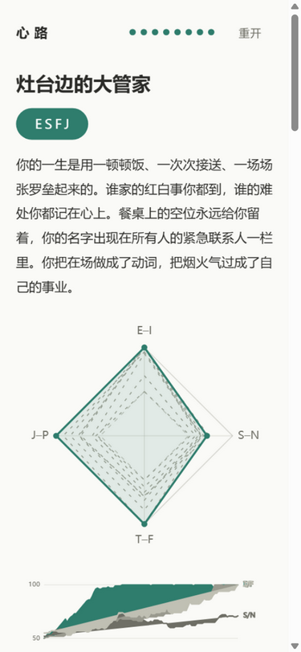

# M5 · 门面与体验清单留痕（2026-10-24）

> 覆盖 plan/04 §M5 三块：5.1 体验打磨、5.2 README 产品页门清单、5.3 DEVELOPMENT.md + demo.gif。
> 全部实机验证在 **构建产物**（`npm run build` → `npm run preview`，localhost:4173）上进行，
> 视口 375×812（IAB 逐点操作）；验证完成后 preview 进程已按纪律清杀（netstat → taskkill）。

## 一、5.1 体验打磨（引擎面零改动，K11 契约不动）

| # | 打磨项 | 位置 | 动机 |
|---|---|---|---|
| 1 | 重开两步确认的**确认态复位**：移开指针/焦点即解除「确认重开？」武装 | `src/ui/app.ts` bindRestart | 修真实缺陷：确认态一旦误触即永久驻留，之后的任何单击都会不经确认直接清档 |
| 2 | 换屏一律 `scrollTo(0, 0)` | `src/ui/app.ts` render() | 小结/终局是长页面，innerHTML 替换不复位滚动，推进到下一屏会落在页中 |
| 3 | 进度点颜色/描边过渡 0.18s（并纳入 `prefers-reduced-motion` 兜底） | `src/style.css` | 轻动效补齐：阶段推进时进度点突变生硬 |

回归：`npm test` 67/67 绿、`npm run typecheck` 0 错（打磨后复跑）。

## 二、异常路径补测（M3 交付的兜底 UI 不重做，只补测）

| # | 路径 | 实测结果（构建产物上） | 留痕 |
|---|---|---|---|
| 1 | 存档损坏：写入非法 JSON → 刷新 | 「存档无法读取」屏出现；`localStorage` 原文逐字节保留（`{broken-json!!`）；点「重新开始」才清档回开局屏（`cleared: true`） |  |
| 2 | 重开两步确认：单击 → 确认态（`确认重开？`）→ pointerleave | 确认态文本与 `data-armed` 置位正确；指针移开复位为「重开」；复位后第一次单击只重新武装不重开（`rearmStillCard: true`），第二次单击才回开局屏 |  |
| 3 | 局中刷新续局：1 次抉择后刷新 | 恢复到同一张事件卡（`resumeMatch: true`，文本逐字相等） | —（文本对账见上） |
| 4 | 终局刷新续局：终局存档（stageIndex 8）刷新 | 直接回到终局报告屏（`resumedToEnding: true`） | — |
| 5 | 构建产物一键通关冒烟 | 同步 evaluate 循环 190 次交互跑完全部 8 阶段，终局「灶台边的大管家」ESFJ，种子 1805937273 |  |

## 三、demo.gif 录制（docs/assets/demo.gif）

- **方法**：IAB 375×812 实玩流程截 7 个状态帧 → ffmpeg concat + palettegen/paletteuse（128 色）合成，13.2s / 218KB / 无限循环。
- **帧序**：开局屏 → 婴儿期首卡 → 选项反馈 → 下一张卡 → 婴儿期小结（雷达 + 四维 delta）→ 幼儿期卡片 → 终局报告（类型徽章 + 雷达 + 曲线）。
- **录制口径（诚实留痕）**：
  1. 截帧时注入 `.screen { animation: none }` 关闭 0.28s 入场动画——GIF 帧是离散的，半透明中间帧只会造成鬼影；界面内容与真实 settled 状态完全一致；
  2. 中段与终局用同步 evaluate 循环快进（M4 IAB 套路），IAB 渲染节流下截图会拿到滞后的旧合成面，用「暖帧 + 复拍」规避（拍一张丢弃，再等 900ms 拍正式帧）；
  3. GIF 为 M4 六局实玩同款真实 UI 的真实交互序列，非渲染机造假画面。

## 四、README 门清单逐项（04 §M5）

| 门 | 判据 | 实测（2026-10-24） |
|---|---|---|
| 总行数 ≤ 120 | `wc -l README.md` | **76 行** |
| 「30 秒跑起来」≤ 30 行处 | `grep -n "30 秒跑起来"` | **第 11 行**（线上地址 + 本地两条命令齐备） |
| 有真实输出截图 | README 内嵌 | `docs/assets/demo.gif`（实玩录制成）+ 真实终局截图等 docs/assets 留痕 |
| 无里程碑占首屏 | 首屏 = 定位 + 演示 + 30 秒跑起来 | 里程碑状态表移至文末「项目进度」节 |
| README 无 DoD 字样 | `grep -c "DoD"` | **0 命中** |
| DEVELOPMENT.md 被链接 | `grep -n "DEVELOPMENT.md"` | 「开发」节第 58 行链接可达 |
| 营销词零容忍 | 通读 | 无「极致/颠覆/最强」类词；定位句只陈述可验证事实 |

已知限制：照抄 plan/01 §十五条，逐字未改。人格模型依据表：照 data/README.md 三态表转写（2 ✅ + 1 🟡，注明软论据）。

## 五、数字对账（06 §八类之 3，README ↔ `npm run validate -- --count`）

| 数字 | validate --count 输出 | README 表述 | 一致 |
|---|---|---|---|
| 事件总数 | 112 | 「8 个阶段共 112 条事件」 | ✅ |
| 结局 | 条件结局 8 + 兜底 1 | 「8 条件结局 + 1 兜底结局」 | ✅ |
| 画像 | 16/16 型在位 | 「16 型 MBTI 画像」 | ✅ |
| birth-map | 288/288 组合 | 「四要素共 288 种组合」 | ✅ |
| 重大抉择 | 每阶段 critical 2 × 8 | 「16 次重大抉择」 | ✅ |

## 六、实物表核对（00 §提交材料实物表，M5 时点）

| 承诺项 | 路径 | 状态 |
|---|---|---|
| 游戏本体 | `dist/index.html` | ✅ 本次构建产出（133ms，gzip JS 31.28kB） |
| 事件库与口径数据 | `src/data/*.json` | ✅ |
| 引擎/结局/存档单测 | `src/**/*.test.ts` | ✅ |
| 产品页 README | `README.md` | ✅ 本档 §四门清单全过 |
| 开发文档索引 | `DEVELOPMENT.md` | ✅ 新建（纯 plan/ 索引，不复制内容） |
| 演示截图/GIF | `docs/assets/demo.gif` | ✅ 本档 §三 |
| 发布留档 / 变更日志 | `plan/05` / `CHANGELOG.md` | ⬜ 待 M6（按 00 实物表口径） |
